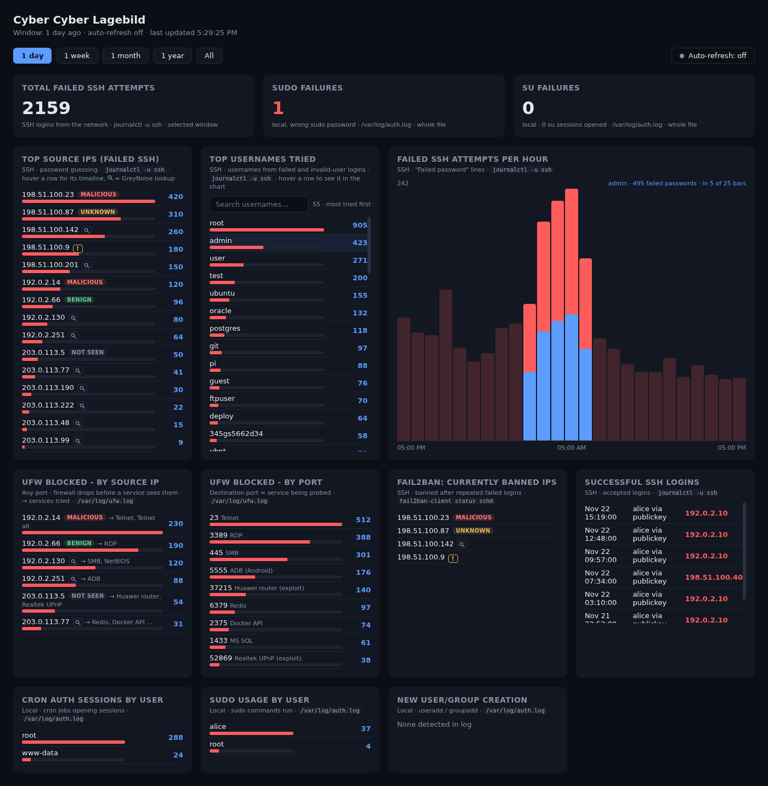

# Cyber Cyber Lagebild

A small, single-file web dashboard that shows who is knocking on your Linux machine from the internet: failed SSH logins, the IPs and usernames bots try, when attacks happen, plus sudo/su/cron/fail2ban/ufw activity from the same logs.

> [!WARNING]
> A personal prototype for quick insights into machines you run, not a complete monitoring tool.
> It has no login and no HTTPS, and it needs root to read the system logs.



*Screenshot with made-up data. The IPs are from the ranges reserved for documentation.*

## Quick setup

On the server:

```bash
sudo python3 app.py --bind 127.0.0.1 --port 8080
```

On your own computer, open a tunnel to it and browse to <http://localhost:8080>:

```bash
ssh -N -L 8080:127.0.0.1:8080 user@your-server
```

The left port is on your computer, the right one is the dashboard's port on the server. `Ctrl+C` closes the tunnel.

The server logs each request to the terminal (client IP, time, request, status). Add `--quiet` to turn that off.

> [!CAUTION]
> Don't use `--bind 0.0.0.0` on a public server. Anyone could read your auth logs, including your usernames and the IPs you log in from.

## Where the data comes from

Nothing is stored. Each page load or refresh runs these reads live on the server:

| Source | Service | Panels |
|---|---|---|
| `journalctl -u ssh` (systemd journal) | SSH (`sshd`) | Failed attempts, source IPs, usernames, timeline, successful logins |
| `/var/log/auth.log` | Local: sudo, su, cron, useradd/groupadd | sudo/su failures, sudo usage, cron sessions, new users/groups |
| `/var/log/ufw.log` (`UFW BLOCK` lines) | Any port the firewall dropped | Blocked source IPs and destination ports |
| `fail2ban-client status sshd` | SSH | Currently banned IPs |
| GreyNoise community API | – | IP classification, only when you click 🔍 |

Only the `journalctl` read uses the selected time range. It keeps only the failed, invalid-user and accepted SSH lines and stops after 60 seconds; if that is not enough, the SSH panels show an error instead of data. The others read the whole current log file.

The usernames and the source IPs in the SSH panels are login attempts against SSH. The ufw panels cover every other port. They show which service was probed, e.g. 23 Telnet, 3389 RDP or 445 SMB.

Clicking 🔍 next to an IP sends that IP from your server to [GreyNoise](https://viz.greynoise.io). Without an API key you get about 25 lookups per day. For more, start the app with `sudo GREYNOISE_API_KEY=... python3 app.py`.

## Requirements

- Debian/Ubuntu with systemd journal (`ssh` unit, `/var/log/auth.log`), systemd 237+ for `journalctl -g` (Debian 10, Ubuntu 18.04 or newer)
- Python 3.7+, standard library only
- Optional: fail2ban, ufw logging (`sudo ufw logging on`)
